<div align="center">

# ฅ^•ﻌ•^ฅ Felinora dots

**Hyprland için siyah, kedi temalı masaüstü ayarlarım: Quickshell shell'i, SDDM giriş ekranı ve Hyprland config'i.**

*My dark, cat-themed Hyprland rice: a Quickshell desktop shell, an SDDM login theme and the Hyprland config. (UI language: Turkish)*

</div>

---

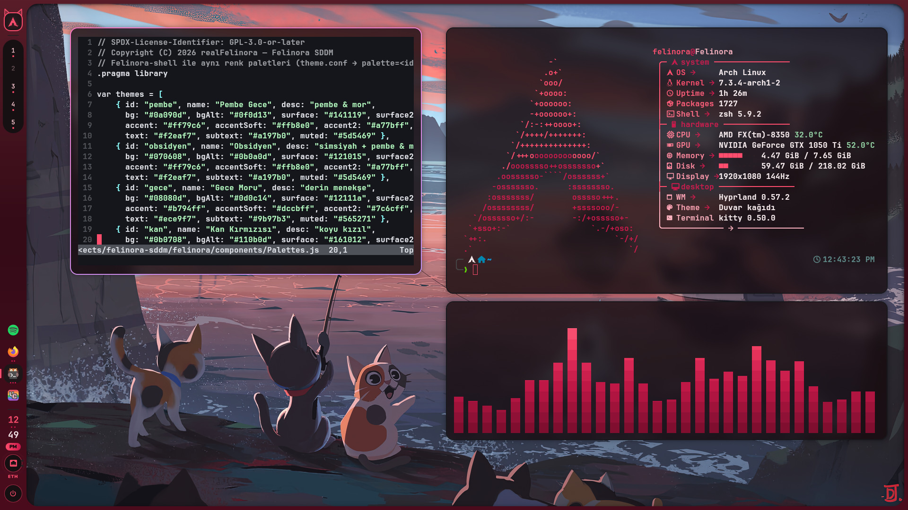

<table>
  <tr>
    <td>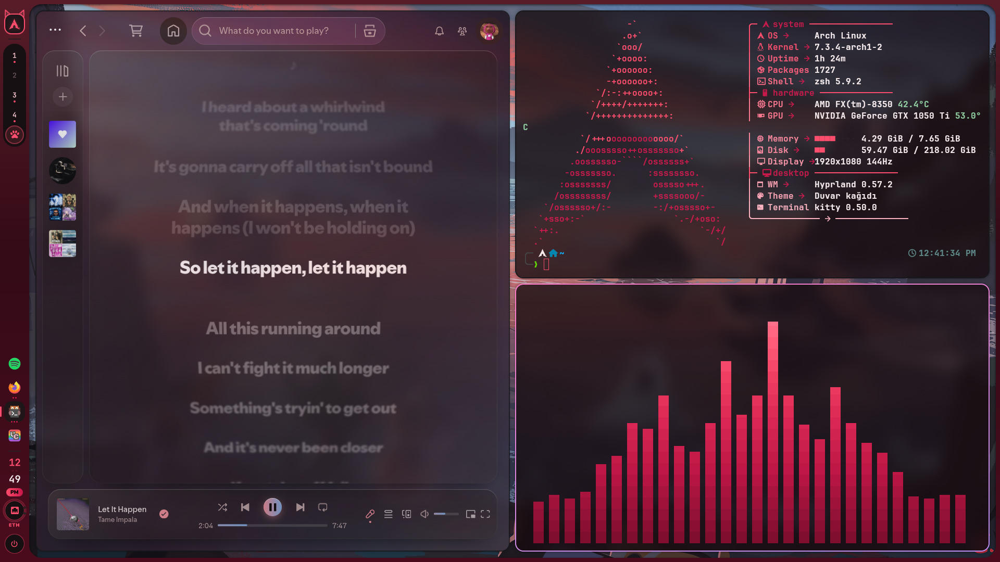<br><sub><b>Çalışma düzeni</b> — Spotify, fastfetch ve cava aynı temada</sub></td>
    <td>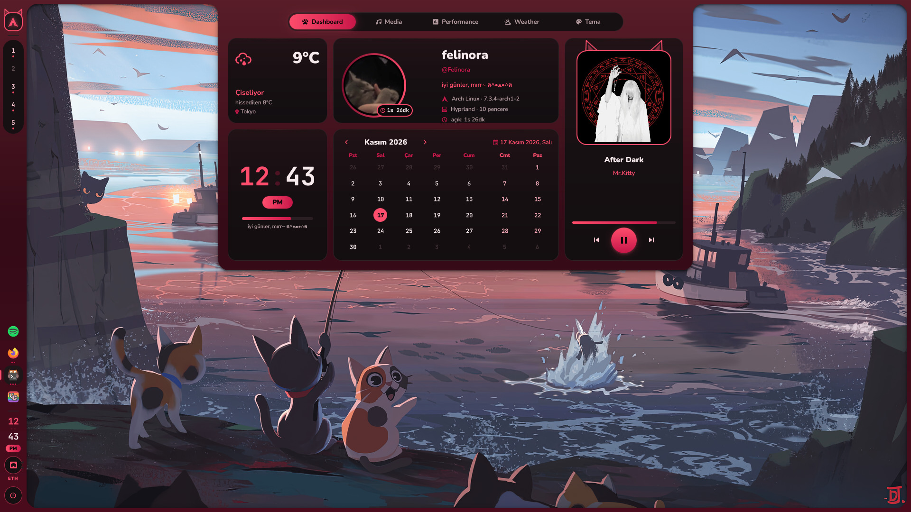<br><sub><b>Dashboard</b> — hava, profil, saat, takvim, medya</sub></td>
  </tr>
  <tr>
    <td>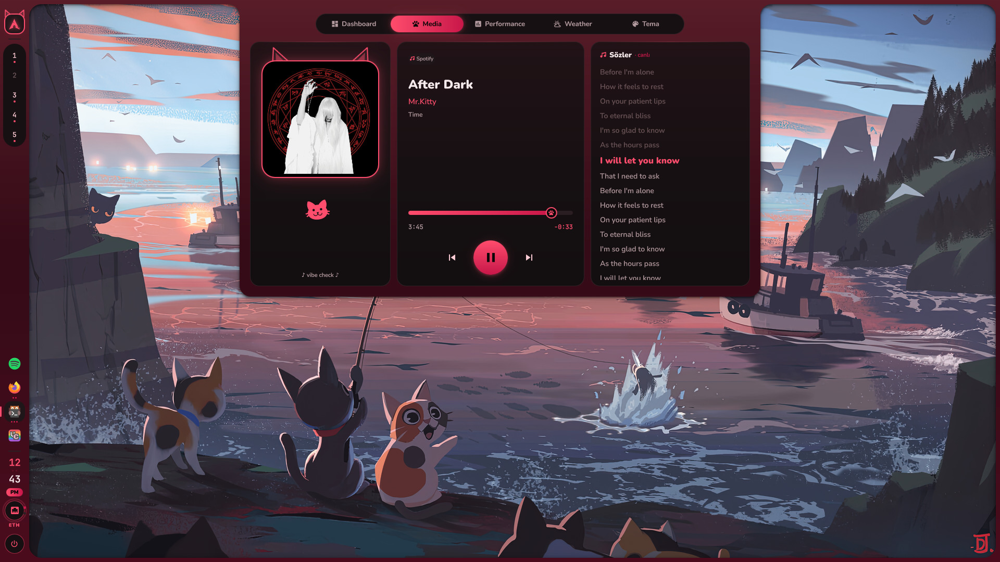<br><sub><b>Media</b> — senkron şarkı sözleri</sub></td>
    <td>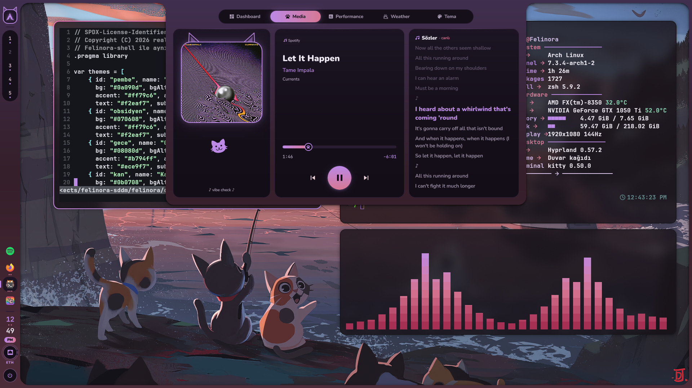<br><sub><b>Şarkı teması</b> — renkler çalan şarkının albüm kapağından gelir</sub></td>
  </tr>
  <tr>
    <td>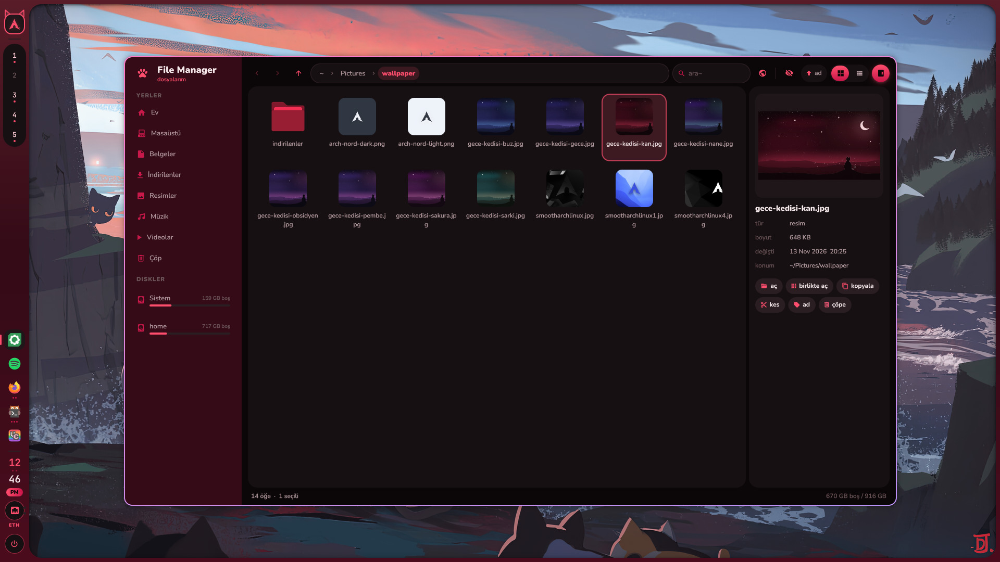<br><sub><b>Dosya yöneticisi</b> — ayrı pencereler, önizleme, başka uygulamalara sürükle-bırak</sub></td>
    <td>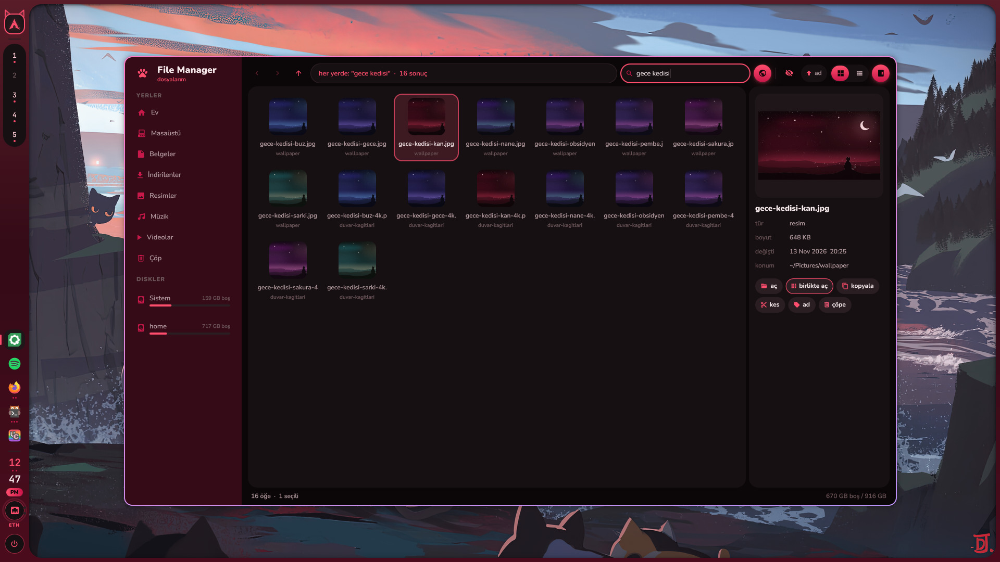<br><sub><b>Her yerde ara</b> — bütün bilgisayarda anında arama</sub></td>
  </tr>
  <tr>
    <td>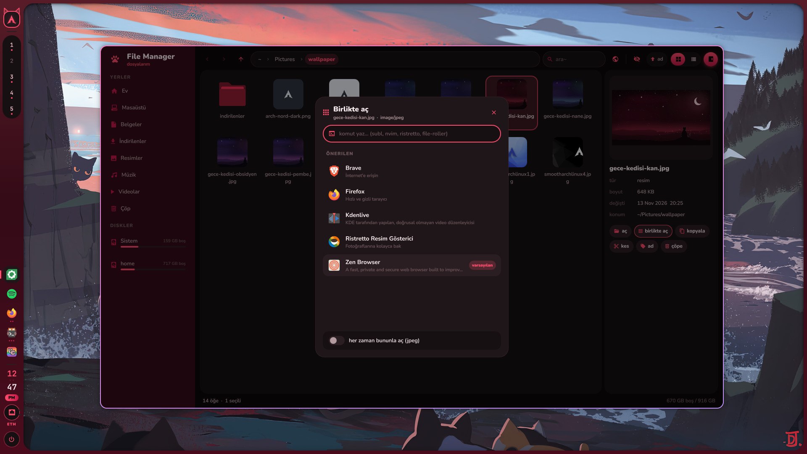<br><sub><b>Birlikte aç</b> — uygulama seç ya da komut yaz</sub></td>
    <td>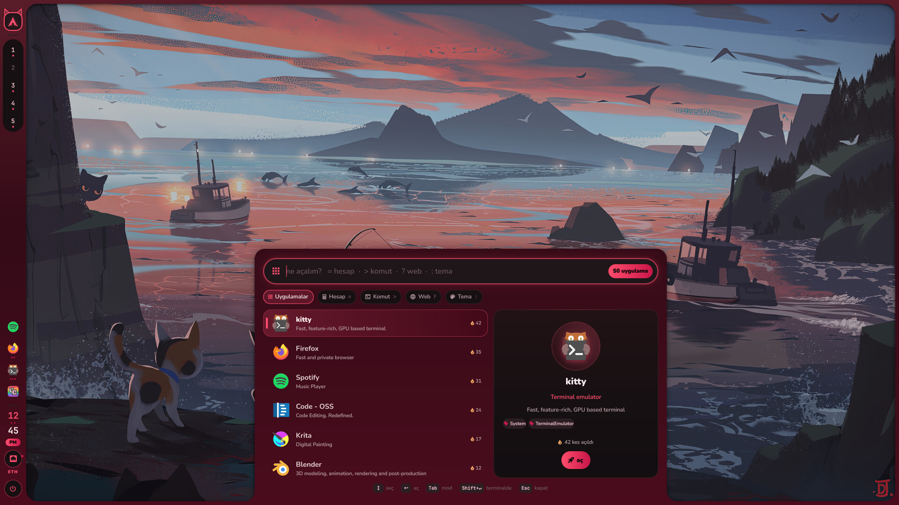<br><sub><b>Program başlatıcı</b> — arama, hesap makinesi, komut, web</sub></td>
  </tr>
  <tr>
    <td>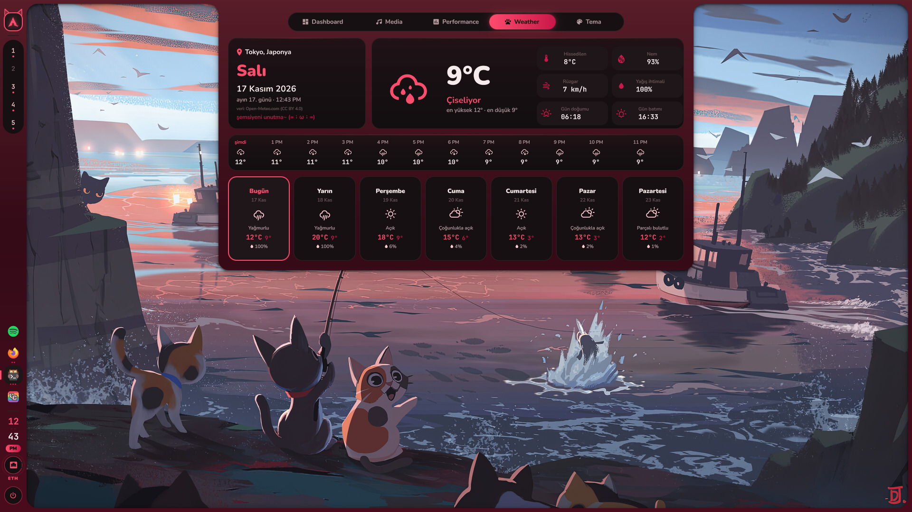<br><sub><b>Weather</b> — saatlik ve 7 günlük tahmin</sub></td>
    <td>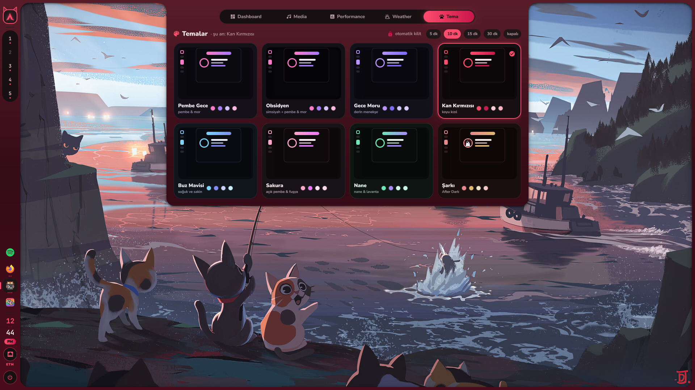<br><sub><b>Temalar</b> — 7 koyu tema + şarkı teması, tek tık</sub></td>
  </tr>
  <tr>
    <td>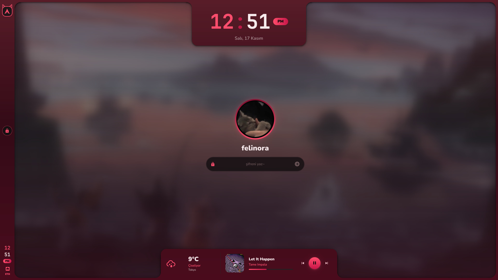<br><sub><b>Kilit ekranı</b> — bulanık duvar kağıdı, hava ve medya</sub></td>
    <td>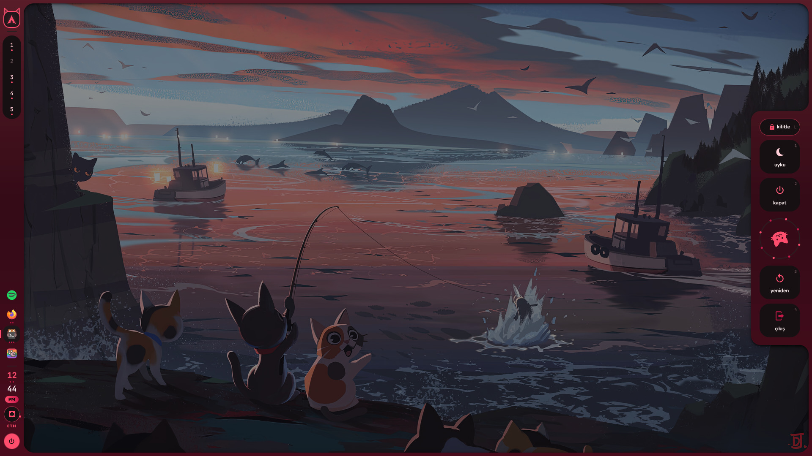<br><sub><b>Çıkış menüsü</b></sub></td>
  </tr>
  <tr>
    <td>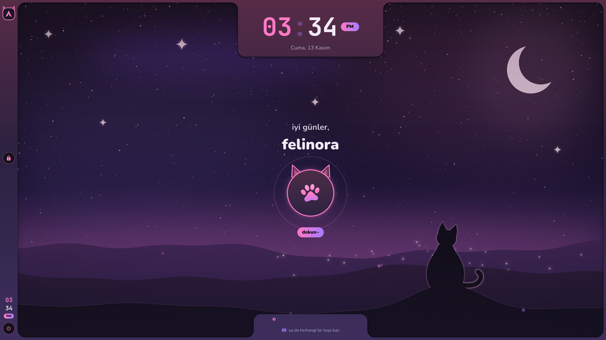<br><sub><b>SDDM</b> — karşılama ekranı</sub></td>
    <td>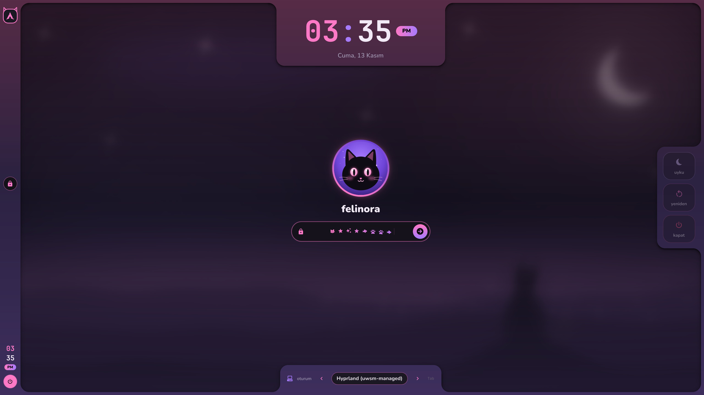<br><sub><b>SDDM</b> — şifre yazarken şekilli patiler</sub></td>
  </tr>
</table>

### 🎨 Temalar — terminal, cava ve fastfetch de birlikte değişir

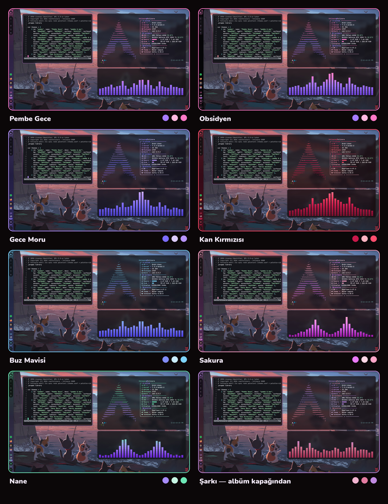

## 📂 İçindekiler

| Klasör | Ne | Kurulum |
|---|---|---|
| [`quickshell/`](quickshell) | **Felinora-shell** — bar, dashboard, başlatıcı, dosya yöneticisi, kilit ekranı, 8 tema | [quickshell/README.md](quickshell/README.md) |
| [`sddm/`](sddm) | **Felinora SDDM** — shell ile aynı renklerde giriş ekranı | [sddm/README.md](sddm/README.md) |
| [`hypr/`](hypr) | **Hyprland** Lua config'i — jöle pencereler, kedi animasyonları, kısayollar | aşağıya bak |

## 🚀 Hızlı kurulum

```sh
git clone https://github.com/realFelinora/dots.git
cd dots

# shell
./quickshell/install.sh

# giriş ekranı (yönetici izni ister)
sudo ./sddm/install.sh --palette kan
```

**Hyprland:** [`hypr/hyprland.lua`](hypr/hyprland.lua) Hyprland 0.57+ Lua config'idir. Kendi config'inin üstüne yazmadan önce yedeğini al; monitör satırını kendi ekranına göre, NVIDIA satırlarını da ekran kartına göre düzenle. Shell'i başlatan ve SUPER+E / M / L / W kısayollarını bağlayan satırlar içinde hazır.

## ⌨️ Kısayollar (hypr/hyprland.lua)

| Kısayol | |
|---|---|
| `SUPER + Enter` | terminal (kitty) |
| `SUPER + E` | dosya yöneticisi (yeni pencere) |
| `SUPER + M` | program başlatıcı |
| `SUPER + W` | duvar kağıdı seçici |
| `SUPER + L` | çıkış menüsü |
| `SUPER + X` | pencereyi kapat |
| `SUPER + V` | yüzen / döşenmiş |
| `SUPER + S` | gizli çalışma alanı |
| `SUPER + 1…0` | çalışma alanı (`+ SHIFT`: pencereyi taşı) |
| `Print` | alan seçip ekran görüntüsü |

## 🙏 Teşekkürler

- Ekran görüntülerindeki duvar kağıdı: **sea-cats** (sağ altta "DJ." imzalı çizim, [wallhaven.cc](https://wallhaven.cc) üzerinden). Resmin hakları sanatçısına aittir; bu repoda yer almaz.
- Diğer teşekkürler ve kaynaklar: [quickshell/README.md](quickshell/README.md#-teşekkürler)

## 📄 Lisans

© 2026 **realFelinora** — [GNU General Public License v3.0 veya sonrası](LICENSE).

Geliştirme sırasında yapay zekâ asistanı **Claude** (Anthropic) yardımıyla yazıldı.
