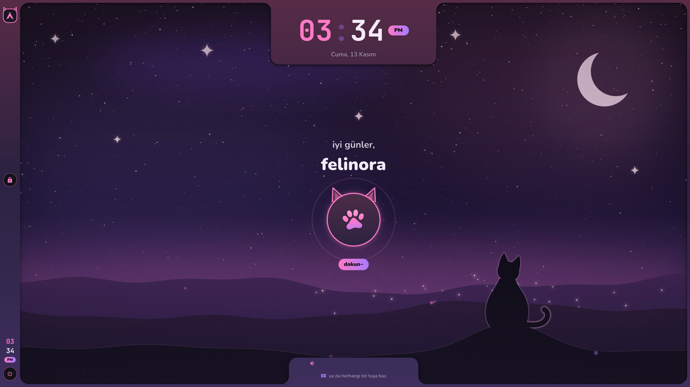
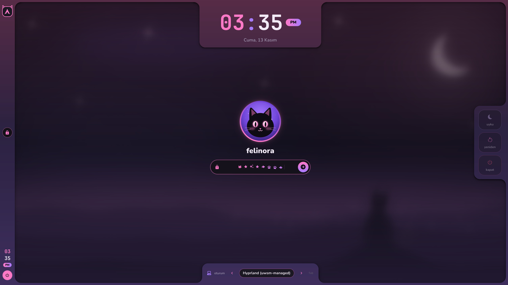

<div align="center">

# ฅ^•ﻌ•^ฅ Felinora SDDM

**SDDM için siyah, kedi temalı giriş ekranı (Qt 6).**

*A dark, cat-themed SDDM login theme (Qt 6). UI language: Turkish.*

</div>

---

<table>
  <tr>
    <td><br><sub><b>Karşılama</b> — tıkla ya da bir tuşa bas</sub></td>
    <td><br><sub><b>Giriş</b> — şifre yazarken şekilli patiler</sub></td>
  </tr>
</table>

<sub>Görüntülerdeki duvar kağıdı ve profil resmi bu README için özel hazırlandı.</sub>

Önce bir karşılama ekranı çıkar. Tıklayınca ya da bir tuşa basınca kilit ekranı tarzındaki giriş gelir; basılan tuş şifre kutusuna yazılmaz. Şifre yazarken her karakter zıplayan şekilli bir pati olur. Giriş ekranında `Esc`'ye basınca veya bir süre hiçbir şey yapılmayınca karşılama ekranına geri döner.

[Felinora-shell](../quickshell) ile aynı 7 renk temasını kullanır, ama tek başına da çalışır.

## 📦 Gereksinimler

- SDDM (Qt 6 greeter: `sddm-greeter-qt6`)
- Fontlar: **Nunito**, **JetBrainsMono Nerd Font** (Arch: `ttf-nunito`, `ttf-jetbrains-mono-nerd`)

## 🚀 Kurulum

```sh
git clone https://github.com/realFelinora/dots.git
cd dots/sddm
sudo ./install.sh --palette gece \
    --background ~/Resimler/arkaplan.png \
    --avatar ~/Resimler/profil.png

# oturumu kapatmadan denemek için:
sddm-greeter-qt6 --test-mode --theme /usr/share/sddm/themes/felinora
```

| Seçenek | |
|---|---|
| `--palette` | `pembe` · `obsidyen` · `gece` · `kan` · `buz` · `sakura` · `nane` (varsayılan: `pembe`) |
| `--background` | arka plan resmi (boşsa temanın renklerinde degrade) |
| `--avatar` | profil resmi (boşsa sistemdeki kullanıcı resmi, o da yoksa ikon) |
| `--os` | dağıtım logosu (varsayılan: `/etc/os-release`'ten) |

Diğer ayarlar (`clock24`, `idleSeconds`) `/usr/share/sddm/themes/felinora/theme.conf` dosyasında. SDDM ev klasörünü okuyamaz; bu yüzden kurulum scripti resimleri tema klasörüne kopyalar.

Önceki temaya dönmek için: `sudo rm /etc/sddm.conf.d/10-felinora.conf`

## 📄 Lisans

Copyright (C) 2026 realFelinora

Bu program özgür yazılımdır: [GNU General Public License v3.0 veya sonrası](../LICENSE) koşulları altında dağıtabilir ve/veya değiştirebilirsiniz.

Geliştirme sırasında yapay zekâ asistanı **Claude** (Anthropic) yardımıyla yazıldı.
